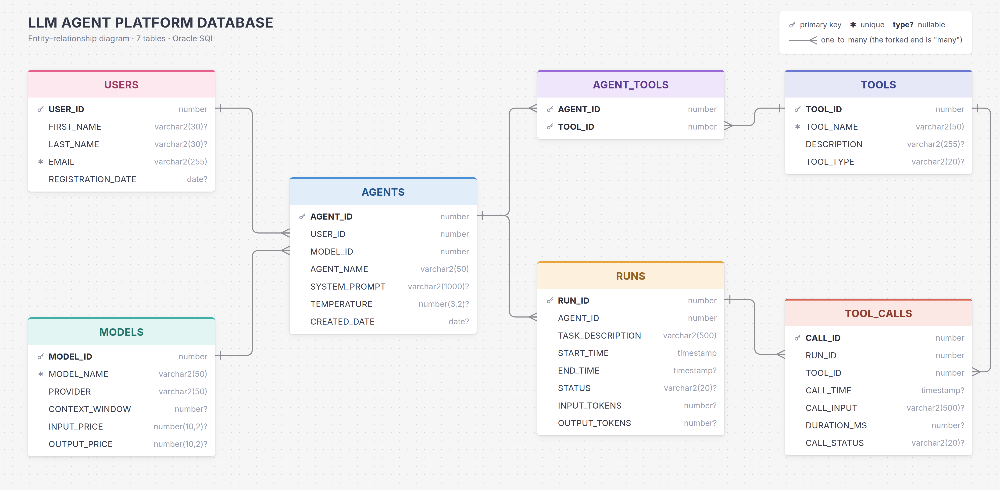

# LLM Agent Platform Database

An SQL assignment and its solution (Oracle SQL). Users build AI agents on top of
large language models, give the agents tools, and run them on tasks.

## Files

| File | What it is |
|---|---|
| `LLM_Agent_Platform_Database.pdf` | The assignment: tables, relationships, constraints, sample data and required queries |
| `LLM_AGENT_PLATFORM_DATABASE.sql` | The solution: 7 tables, sample data and 5 simple queries in 46 lines |
| `LLM_Agent_Platform_ER_Diagram.png` / `.webp` | The ER diagram |

## Tables

| Table | Holds |
|---|---|
| `USERS` | People who use the platform |
| `MODELS` | Language models and their price per 1M tokens |
| `AGENTS` | Agents, with their owner and model |
| `TOOLS` | Tools agents can use |
| `AGENT_TOOLS` | Which agent may use which tool (many-to-many) |
| `RUNS` | Each task given to an agent |
| `TOOL_CALLS` | Each tool call made during a run |

Model names and prices are made up.

## How to run

Run `LLM_AGENT_PLATFORM_DATABASE.sql` from top to bottom in Oracle (SQL Developer,
Oracle Live SQL or SQL\*Plus). It was tested on Oracle Database 23ai Free.
